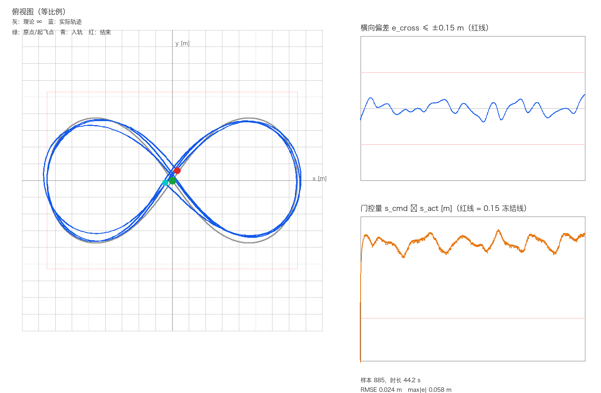
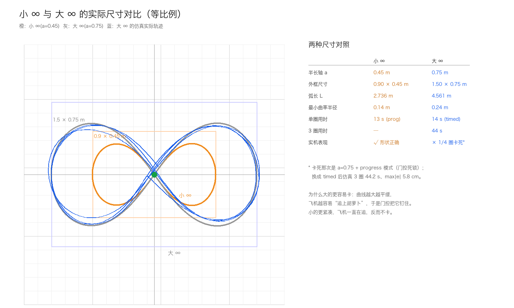
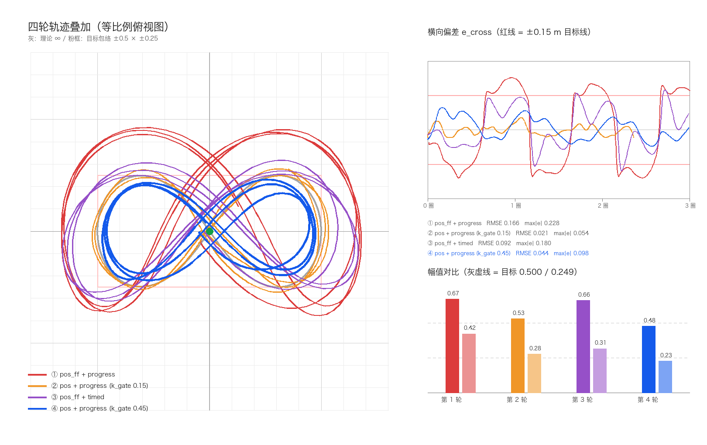

# AirHust 梯队任务 · ∞ 自编动作

> 智能无人机实践（一）第二次验收（11/22）参赛作品：在课程 `square` 的基础上，自编一段**连续曲线飞行**——沿伯努利双纽线（∞ 形）闭合飞 3 圈，然后自动回到起飞点降落。
>
> 平台：ROS Noetic + PX4 + MAVROS（OFFBOARD）｜场地：约 1.5 × 0.75 m 包络、高度 0.8 m

---

## 目录

- [一、做了什么](#一做了什么)
- [二、成果数据](#二成果数据)
- [三、技术要点](#三技术要点)
- [四、目录结构](#四目录结构)
- [五、部署与运行](#五部署与运行)
- [六、关键参数](#六关键参数)
- [七、踩过的坑](#七踩过的坑)

---

## 一、做了什么

| 原 `square` | 本作品 |
|---|---|
| 4 个离散定点依次飞 | 一条**连续曲线**（双纽线）闭环飞 3 圈 |
| 每点停下判到位、原地转机头 | 全程不停顿、不悬停、不转机头 |
| 任务层写死航点 | 曲线在任务层生成，跟踪能力放在 `template` 库层 |

**改动分两层**：

1. **库层**（`template/include/template.h` 末尾追加 397 行）
   - `TrajRef` + `traj_send()`：位置 / 前馈速度 / yaw 的统一打包，支持三种控制模式
   - `PathLUT` + `path_build / path_project / path_sample`：任意闭合曲线的等弧长参数化、投影、取样、曲率限速
   - `TrajStat`：跟踪误差统计（RMSE / max / 幅值 / 闭合误差）
   - `TrajCsv`：飞行数据落盘，落地后可直接出图
2. **任务层**（`mission/src/figure8.cpp`，约 500 行）
   - 曲线生成 + 状态机（起飞 → 稳姿态 → 跟踪 → 回原点 → 降落）
   - 弧长进度门控、曲率限速、yaw 摆动
   - 安全保护：横向偏差超限自动悬停、总时长超时回原点

---

## 二、成果数据

**大 ∞（a = 0.75 m）Gazebo + PX4 SITL 仿真，3 圈**：

| 指标 | 实测 |
|---|---|
| 曲线幅值 | x ±0.750 m、y ±0.374 m（外框 1.50 × 0.75 m） |
| 单圈弧长 / 3 圈 | 4.5605 m / 13.68 m |
| 完成弧长 | 13.669 m |
| 用时 | 44.20 s（平均 0.319 m/s） |
| **横向误差 RMSE** | **0.0236 m** |
| **横向误差最大** | **0.0575 m** |
| 三圈重复性 | 15.70 / 14.15 / 14.35 s，轨迹几乎完全重合 |
| 闭合误差 | 0.065 m |





**四轮参数对照**（同一份代码，只改控制模式）：

| # | ctrl_mode | track_mode | 用时 | RMSE | max\|e\| | x 幅值 |
|---|---|---|---|---|---|---|
| ① | pos_ff | progress | 28.1 s | 0.166 | 0.228 | 0.67 |
| ② | pos | progress | 超时 2.3 圈 | 0.021 | 0.054 | 0.53 |
| ③ | pos_ff | timed | 21.1 s | 0.092 | 0.180 | 0.66 |
| ④ | **pos** | **progress** | 28.5 s | 0.044 | 0.098 | 0.48 |



### 实机验证（11-22 验收）

两飞策略：先飞 1 圈小圈（a = 0.45）做健康检查，再飞 3 圈全尺寸（a = 0.75）。

**结果：两次均成功，全程无接管，自动回原点降落、正常结束。**

现场视频：[Figure∞考核实飞记录.mp4](04-录屏/Figure∞考核实飞记录.mp4)（18 MB）
实机记录：[2026-11-22-实机验收记录.md](02-记录/2026-11-22-实机验收记录.md)

> 考核是限时形式，飞完立刻交下一组，没来得及从机载电脑拷 CSV，所以本次只有
> 定性记录与视频；量化数据见上方的仿真结果。

---

## 三、技术要点

### 1. 曲线选型：伯努利双纽线

```
x(θ) = a·cosθ / (1 + sin²θ)
y(θ) = k·a·sinθ·cosθ / (1 + sin²θ)
```

选它的两个理由：

- **曲率处处连续**（格罗诺双纽线在瓣顶有尖角，最小曲率半径只有 0.10 m，实机会被"切角"）
- **自交点正好落在起飞点**，起飞即入轨，飞完 3 圈自然回到原点

实测参数：a = 0.75、k = 1.41 → 幅值 ±0.75 / ±0.374 m、单圈弧长 4.5605 m、最小曲率半径 0.22 m。

### 2. 等弧长参数化

曲线先稠密采样 1440 点，再按弧长重采样成 2000 点，同时计算每点的**切向**与**曲率**。
这样 `s` 与索引是线性关系，取样是 O(1)；曲率还能直接用来做曲率限速 `v = min(v_max, √(a_lat·R))`。

### 3. 三种控制模式（可 yaml 切换）

| 模式 | type_mask | 特点 |
|---|---|---|
| `pos_ff` | 位置 + xy 速度前馈 | PX4 多飞出一圈"外鼓"，实测半径方向偏出 0.12–0.17 m |
| `pos` | 纯位置（与 `mission_pos_cruise` 一致） | **最终采用**，最准 |
| `vel` | xy 纯速度 + z 位置 | 仅作对照 |

### 4. 进度门控与它的死锁

`progress` 模式下参考点最多领先实际进度 `k_gate`（"胡萝卜"）。好处是飞机落后时先保形状；
但真机上出现过一个**死锁**：飞机追到胡萝卜 → 位置误差为 0 → 不再移动 → `s_act` 不涨 →
参考点被压回 `s_act + k_gate` → 双方互等，永久静止。

修复：
- 代码层：`s_act` 连续 0.5 s 不增长就**释放门控**强制推进；
- 运行层：改用 `timed` 模式（参考点按时间匀速前进，逻辑上不可能死锁）。

### 5. 安全保护

- 横向偏差 > `dev_max`（0.3 m）持续 0.5 s → **冻结参考 + 原地悬停**，等人接管
- 总时长 > `laps × L ÷ v_min × 2` → 回原点降落
- 回原点用**径向判据**（`hypot < 0.05`），不是分轴判据

---

## 四、目录结构

```
.
├── 00-总览.md              项目总览（进度、评分对应、两飞方案）
├── 01-操作卡/              现场操作卡、说明稿、部署与清理脚本
├── 02-记录/                飞行记录、数据卡、CSV、俯视图
├── 03-代码/                源码与画图脚本
│   └── template2026_ws/    与机载电脑同构的交付代码
│       ├── src/template/include/template.h   （原文件 + 追加 397 行）
│       ├── src/mission/src/figure8.cpp
│       ├── src/mission/config/figure8.yaml
│       ├── src/mission/launch/figure8.launch
│       ├── src/mission/CMakeLists.txt
│       └── shell/figure8.sh
├── 04-录屏/                仿真录屏
├── 05-学习资料/            课程资料（官方 square 原理讲解）
└── 06-备份/                可一键部署的压缩包
```

---

## 五、部署与运行

**依赖**：课程 `template2026_ws` 工作空间（含 `template`、`mission` 两个包）

```bash
# 1. 传包到机载电脑并安装（脚本幂等，会自动备份 template.h / CMakeLists.txt）
scp 06-备份/2026-11-22-fig8-现场定稿包.tgz airhust@<机载IP>:~/fig8.tgz
ssh airhust@<机载IP> 'mkdir -p ~/fig8 && tar xzf ~/fig8.tgz -C ~/fig8 && bash ~/fig8/fig8-setup.sh'

# 2. 起任务（tmux 三屏：roscore / fly_demo / 任务节点）
cd ~/template2026_ws && ./shell/figure8.sh

# 3. 面板提示后输 1，再把遥控器拨到 OFFBOARD
```

**仿真**（UTM + Gazebo + PX4 SITL）：`bash ~/fig8/fig8-sim.sh` → `bash tools/run_task.sh figure8`

---

## 六、关键参数

`mission/config/figure8.yaml`：

| 参数 | 值 | 说明 |
|---|---|---|
| `curve` | bernoulli | 曲线类型 |
| `curve_a` / `curve_y_scale` | 0.75 / 1.41 | 半长轴 / y 拉伸 |
| `altitude` | 0.8 m | 相对起飞点高度 |
| `ctrl_mode` | `pos` | 纯位置（最准） |
| `track_mode` | `timed` | 按时间推进（无死锁） |
| `v_max` / `v_min` | 0.22 / 0.18 m/s | 弧长速度 |
| `laps` | 3 | 圈数 |
| `yaw_mode` | `fixed` | 机头固定（`sweep` 会缓慢摆头 ±14°） |
| `dev_max` / `dev_time` | 0.30 m / 0.5 s | 偏差保护 |

现场为了稳妥采用**两飞策略**：先飞 1 圈小的（a = 0.45）做健康检查，再飞 3 圈大的。

---

## 七、踩过的坑

1. **速度前馈会让 ∞ 外鼓 1.3 倍**——PX4 吃到前馈速度后会冲过参考点，跑到曲线外侧。
2. **进度门控 + 纯位置会死锁**——仿真的"一阶滞后"模型抓不到，只有在真机上才会追到胡萝卜。
3. **`mission_pos_cruise` 用的是分轴判据**，径向 0.17 m 也可能被判"到达"，导致落点偏离原点。
4. **回原点后要重新判据**，否则 `precision_land` 会锁定当前位置就地降落。

---

## 参考

- 课程工作空间：`hus-king/template2026_ws`（`template` / `mission` 包）
- 任务书：《智能无人机实践（一）第二次验收任务书（飞行验收版）》
